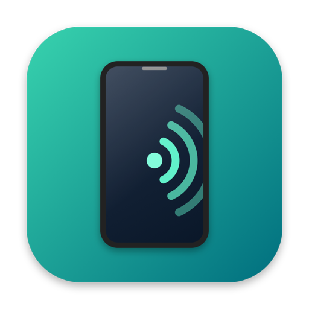

<div align="center">



# My Android

**Твой Android-телефон прямо на экране Mac.**

Зеркалирование, управление, скриншоты и перетаскивание файлов — всё из меню-бара.
Без проводов к облаку, без аккаунтов, без телеметрии.

[](#требования)
[](#сборка-из-исходников)
[](#требования)
[](LICENSE)
[](https://bazarow.ru)

</div>

---

## Что это такое

My Android — маленькая программа для macOS, которая живёт в меню-баре и делает
одну вещь: показывает экран твоего Android-телефона на компьютере. Тыкаешь
мышкой в телефон, печатаешь с клавиатуры мака, снимаешь скриншоты, таскаешь
файлы в обе стороны.

По сути это «My iPhone» для Android — то, чего Apple сама не сделала.

Приложение ничего не настраивает и ни о чём не спрашивает. Воткнул кабель —
через пару секунд на экране появилось окно телефона. Выдернул — окно исчезло,
программа ждёт следующего подключения.

**Оно полностью самодостаточное.** Внутри лежит всё нужное: движок
зеркалирования, драйвер ADB и библиотеки. Скопировал `.app` на другой Mac —
запустил — работает. Никакого Homebrew, никаких `brew install` на целевой
машине, никаких зависимостей.

---

## Возможности

### Зеркало экрана

Окно с экраном телефона. Свободно тянется мышью за любой угол, разворачивается
на весь экран, ставится поверх других окон одним переключателем.

- **1920 px по длинной стороне, 60 кадров в секунду.** Картинка масштабируется
  под размер окна сама, поэтому разрешение не приходится подбирать вручную.
- **Кодек H.264.** Выбран не случайно: на macOS он декодируется аппаратно через
  VideoToolbox, а на телефоне аппаратный энкодер H.264 самый отзывчивый. H.265
  жмёт сильнее, но добавляет задержку — при 60 кадрах это чувствуется как
  «мышка водит с опозданием».
- **Экран телефона не гаснет**, пока идёт зеркалирование. Иначе зеркало
  показывает чёрный прямоугольник.

Управление привычное: клик — тап, прокрутка — свайп, клавиатура мака печатает
в приложениях телефона.

### Управление кнопками

Из меню доступны аппаратные кнопки телефона, даже если сам телефон лежит
в кармане:

| Пункт меню | Что делает |
|---|---|
| **Домой** | На главный экран |
| **Назад** | Шаг назад |
| **Недавние** | Список открытых приложений |
| **Громче** / **Тише** | Регулировка громкости |
| **Разбудить экран** | Включает погасший экран |

### Скриншоты

Нажал `⌘S` в меню — на рабочем столе появился PNG. Имя вида
`MyAndroid_2026-11-10_15-42-07.png`, по времени снимка.

Снимок делается **напрямую с телефона**, а не с окна зеркала. Поэтому
получается родное разрешение матрицы — например, 1272×2772, а не урезанные
1920. И работает даже когда зеркало выключено: достаточно, чтобы телефон был
подключён.

После снимка выскакивает уведомление — чтобы не гадать, сработало или нет.

### Перетаскивание файлов в обе стороны

Самая удобная часть. Работает как обычный drag & drop в Finder.

**С мака на телефон.** Тащишь любой файл — фотографию, документ, APK — прямо
на окно зеркала и бросаешь. Файл уезжает на телефон в папку `Download`.
Ничего нажимать не надо, scrcpy заливает его сам.

**С телефона на мак.** Открываешь «Файлы телефона…» (`⌘F`), находишь нужное
и тащишь наружу — в Finder, на рабочий стол, в любую открытую папку. Файл
скачается ровно в тот момент, когда ты его отпустил. Передумал тащить —
ничего не качается, трафик не тратится.

### Браузер файлов телефона

Отдельное окно для работы с памятью телефона:

- двойной клик по папке — зайти внутрь
- кнопка вверх — на уровень выше
- кнопка «домой» — быстрое меню с типовыми папками: **Внутренняя память,
  DCIM, Pictures, Download, Movies, Music, Documents**
- **Загрузить…** — залить файлы с мака в текущую папку телефона
- **Скачать…** — сохранить выбранное на мак в выбранную папку
- перетащить файлы с мака прямо в список — загрузятся на телефон

У каждого файла видно иконку по типу (фото, видео, музыка, архив, APK,
документ), размер и дату изменения.

### Индикация состояния

В меню всегда видно, что происходит:

- строка заголовка: `CPH2795 — 93% ⚡︎` (модель, заряд, молния при зарядке)
- вторая строка: `Android 16 · API 36`
- иконка в меню-баре меняется, если телефон отключён

Если телефон не подключён при запуске, программа не молчит, а показывает
окошко с подсказкой: воткни кабель, разблокируй, подтверди отладку. Как только
телефон появится — окошко закроется само, а зеркало поднимется.

---

## Установка

### Что нужно на телефоне

1. **Android 5.0 или новее.**
2. **Включить режим разработчика.** Настройки → О телефоне → семь раз тапнуть
   по «Номер сборки».
3. **Включить отладку по USB.** Настройки → Для разработчиков → «Отладка по USB».
4. Подключить кабель и **подтвердить запрос** «Разрешить отладку по USB?»
   на экране телефона. Галочку «Всегда разрешать с этого компьютера» лучше
   поставить.

> Некоторые прошивки (Xiaomi, Samsung) дополнительно требуют включить
> «Установка через USB» или отключить проверку подписи — это только для
> перетаскивания APK, для зеркала не нужно.

### Что нужно на Mac

Ничего, кроме самого приложения. macOS 13 (Ventura) или новее.

### Запуск

```
1. Скопировать My Android.app в папку «Программы»
2. Запустить
3. Воткнуть телефон
```

Иконка появится и в Dock, и в меню-баре справа. В Dock — чтобы приложение
было видно и закрывалось привычным способом.

> **Первый запуск на чужом Mac.** Приложение подписано ad-hoc, без
> Developer ID, поэтому Gatekeeper может сказать «не удалось проверить
> разработчика». Это нормально: правый клик по приложению → «Открыть» →
> «Открыть» в диалоге. Дальше запускается обычным способом.

---

## Горячие клавиши

| Клавиши | Действие |
|---|---|
| `⌘S` | Скриншот на рабочий стол |
| `⌘F` | Открыть файлы телефона |
| `⌘Q` | Выход |

---

## Как это устроено

Внутри приложения работают два проверенных инструмента:

- **[scrcpy](https://github.com/Genymobile/scrcpy)** — движок зеркалирования
  от Genymobile. Именно он передаёт картинку и обрабатывает ввод.
- **ADB** (Android Debug Bridge) — штатный инструмент Android для связи
  с компьютером. Через него снимаются скриншоты, нажимаются кнопки,
  читается батарея и передаются файлы.

Приложение — это удобная обёртка вокруг них: меню-бар, окно файлов,
перетаскивание, автоопределение телефона. Оба инструмента вместе со всеми
библиотеками упакованы внутрь `.app`, поэтому снаружи ничего ставить не надо.

Зеркало поднимается с такими параметрами:

```
--max-size 1920 --max-fps 60 --video-codec h264
--stay-awake --window-title "My Android" --push-target /sdcard/Download/
```

Иконка в Dock — своя, приложения. Сам scrcpy запускается со скрытой
иконкой (переменная SDL_MAC_BACKGROUND_APP), поэтому в Dock не появляется
второй значок.

Телефон опрашивается каждые 2 секунды. Как только `adb` видит устройство
в состоянии `device` — запускается scrcpy. Пропал — scrcpy закрывается,
приложение остаётся жить и ждёт.

---

## Требования

| | |
|---|---|
| **macOS** | 13.0 Ventura или новее |
| **Процессор** | Apple Silicon (arm64) |
| **Android** | 5.0+ с включённой отладкой по USB |
| **Кабель** | USB, поддерживающий передачу данных (не только зарядку) |

> Кабели «только для зарядки» — самая частая причина, почему телефон
> не находится. Если `adb devices` пуст, а телефон заряжается, — дело в кабеле.

---

## Сборка из исходников

```bash
git clone https://github.com/mibazarow/my_android.git
cd my_android
./build.sh
```

Готовое приложение появится в `build/My Android.app`.

Собрать и сразу запустить:

```bash
./build.sh --run
```

### Что нужно для сборки

Приложение — Swift, но движок зеркалирования собирается из исходников,
поэтому нужен инструментарий:

```bash
xcode-select --install
brew install meson ninja openjdk@21
brew install --cask android-platform-tools
```

Нужен также [Android SDK](https://developer.android.com/studio) — из него
берётся `build-tools` для сборки сервера под телефон.

### Как это работает

`build.sh` делает три вещи:

1. Компилирует приложение на Swift — `Sources/MyAndroid/`.
2. Собирает движок из исходников в `vendor/scrcpy/` через
   `Tools/build-mirror.sh` — отдельно клиент под Mac и сервер под Android.
3. Упаковывает результат вместе со всеми библиотеками внутрь `.app`.

Пересобрать только движок:

```bash
./Tools/build-mirror.sh --clean
```

**Для запуска** готового `.app` не нужно ничего — ни Homebrew, ни SDK.

Весь остальной проект написан на Swift. Никакого Python, ни в сборке,
ни в работе.

---

## Структура проекта

```
Sources/MyAndroid/
  MyAndroidApp.swift             меню-бар, иконка, пункты меню, действия
  MirrorController.swift         запуск и остановка scrcpy, опрос телефона
  MirrorSettings.swift           параметры зеркала, флаг «поверх окон»
  DeviceScanner.swift            разбор вывода `adb devices -l`
  AdbService.swift               кнопки, батарея, информация об устройстве
  AdbFileService.swift           список файлов, скачивание и загрузка
  ScreenshotService.swift        снимок экрана через adb screencap
  DeviceFilesWindow.swift        окно файлов с перетаскиванием
  NoDeviceWindowController.swift окно-подсказка, когда телефона нет
  ToolLocator.swift              поиск инструментов внутри бандла

Resources/
  Info.plist                     паспорт приложения
  Android_Mirror_Start.sh        исходный скрипт запуска, вложен в бандл

Tools/
  IconGen.swift                  рисует иконку кодом
  Vendor.swift                   упаковывает движок, adb и библиотеки в бандл
  build-mirror.sh                собирает движок из vendor/scrcpy

vendor/
  scrcpy/                        исходники движка (форк, Apache 2.0)
  scrcpy-LICENSE                 лицензия движка отдельным файлом

licenses/                        полные тексты всех лицензий
NOTICE.md                        кто чей код, ссылки на оригиналы
```

---

## Частые вопросы

**Телефон не находится.**
Проверь по порядку: кабель поддерживает данные (не только зарядку), на телефоне
включена отладка по USB, в диалоге «Разрешить отладку» нажато «Разрешить»,
телефон разблокирован. Затем выдерни и воткни кабель заново.

**Зеркало показывает чёрный экран.**
Экран телефона погас. Нажми «Разбудить экран» в меню или разблокируй телефон
вручную.

**Приложение не запускается, ничего не происходит.**
Посмотри в Dock — там должна быть иконка My Android, и ещё одна иконка
в меню-баре справа. Если телефона нет, выскочит окошко с подсказкой.

**`adb devices` показывает `unauthorized`.**
На телефоне висит неподтверждённый запрос отладки. Разблокируй телефон и нажми
«Разрешить». Если диалог не появляется — «Отладка по USB» → выключить и
включить заново.

**Скриншот не в родном разрешении.**
Не может быть: снимок идёт через `adb exec-out screencap`, минуя окно зеркала.
Проверь файл в свойствах.

**Перетаскивание файла с телефона ничего не делает.**
Файл скачивается в момент отпускания. Большие файлы могут качаться несколько
секунд — подожди, Finder покажет прогресс.

**Работает ли по Wi-Fi?**
Пока нет, только по кабелю. Беспроводной режим в планах.

**Запись видео с экрана телефона?**
Нет и в ближайшее время не будет: Android блокирует `screenrecord` без root.

---

## Известные ограничения

- Только USB-подключение, без Wi-Fi.
- Запись видео с экрана телефона недоступна — Android её блокирует без root.
- Подпись ad-hoc: на чужом Mac потребуется «Открыть» через правый клик.
- Собрано под Apple Silicon. На Intel-маках не проверялось.

---

## Лицензия

**GNU General Public License v3.0.** Бери, меняй, распространяй — открыто
и с сохранением тех же прав для следующих.

GPL выбрана не из идеологии, а по необходимости: внутри сборки работает
FFmpeg с GPL-компонентами (x264, x265), и это единственный вариант, при
котором права всех авторов соблюдены.

При использовании и распространении обязательно указывать авторство:

> My Android by Михаил Базаров — [bazarow.ru](https://bazarow.ru)

## Чужие права и что мы взяли

Приложение стоит на плечах других проектов. Все авторы перечислены, все
лицензии сохранены в каталоге [`licenses/`](licenses/), все ссылки на
оригиналы — в [`NOTICE.md`](NOTICE.md).

Коротко:

- **Движок зеркалирования** — форк [scrcpy](https://github.com/Genymobile/scrcpy)
  от Genymobile, Apache 2.0. Исходники зафиксированы в `vendor/scrcpy/`
  на версии 4.1, собираем свой бинарник сами.
- **ADB** — официальный инструмент Android, Apache 2.0.
- **Библиотеки** — FFmpeg (GPL), SDL3 (Zlib), libvpx, dav1d, opus, SVT-AV1
  (BSD), mpg123, LAME, libusb (LGPL), OpenSSL (Apache 2.0), XZ (0BSD).

Что именно наше, а что чужое — расписано в [`NOTICE.md`](NOTICE.md)
по разделам.

---

<div align="center">

Сделано [Михаилом Базаровым](https://bazarow.ru)

[](https://bazarow.ru)
[](https://github.com/mibazarow)

</div>